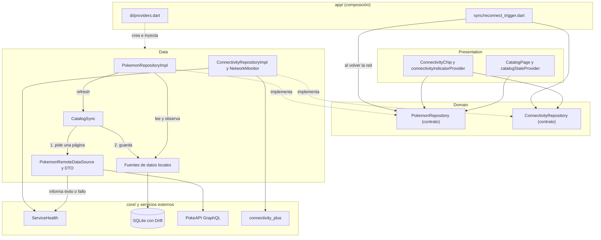
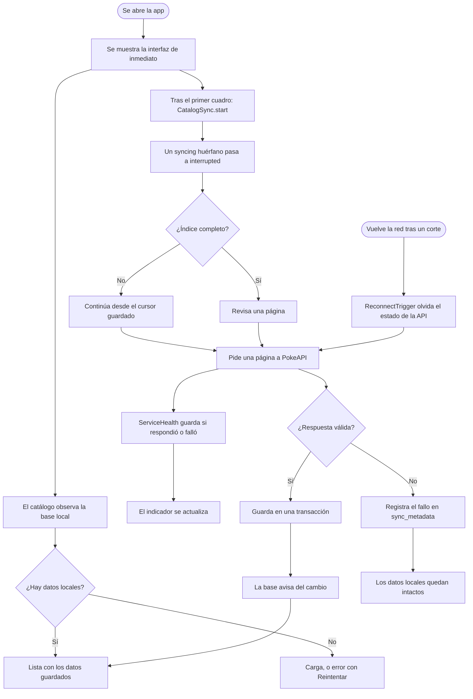
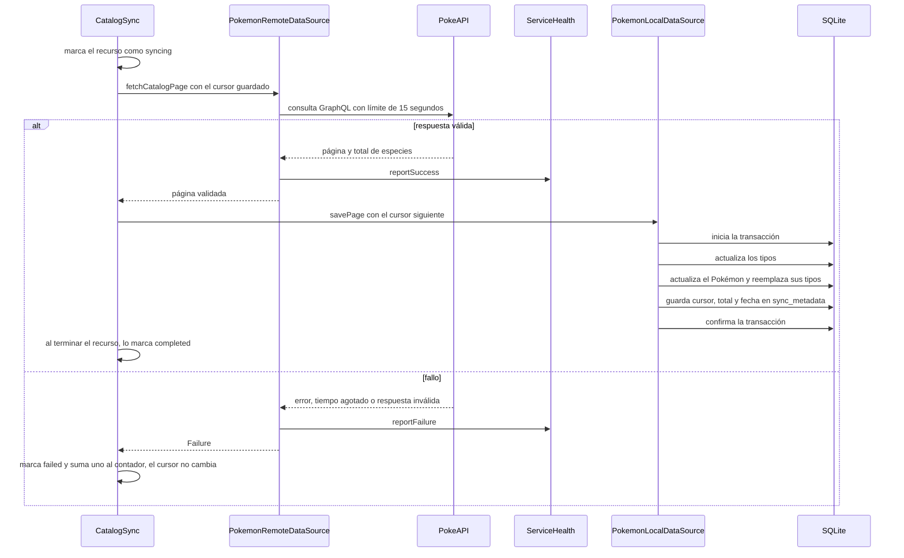
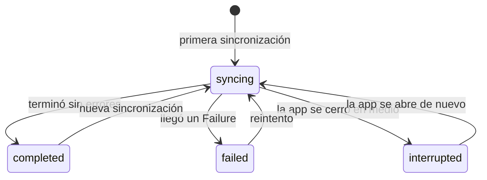
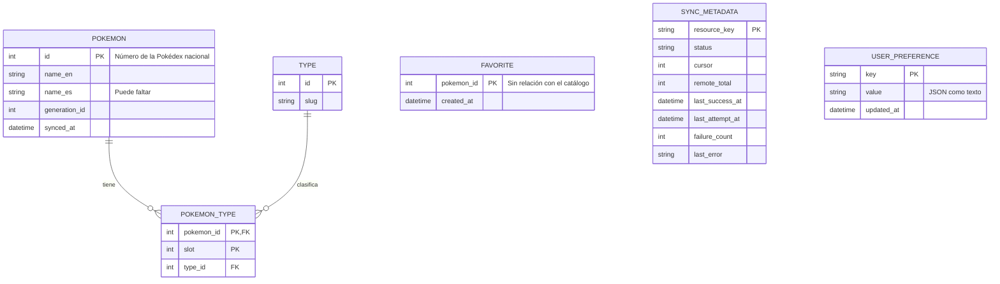
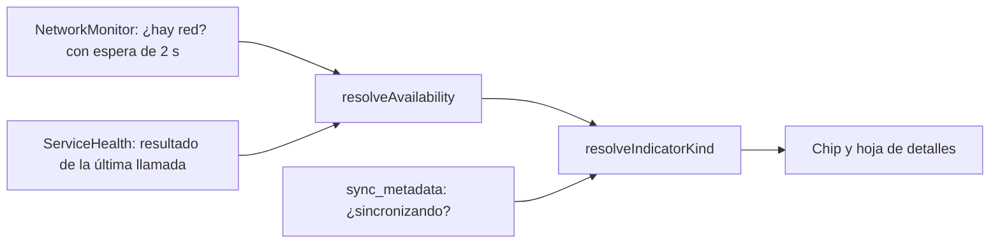

# Arquitectura de la solución

Todos los diagramas están escritos en Mermaid, que GitHub dibuja directamente.
Reflejan el código de este repositorio, y deben actualizarse si el código cambia.

1. [Arquitectura general](#1-arquitectura-general)
2. [Estructura del proyecto](#2-estructura-del-proyecto)
3. [Flujo online y offline](#3-flujo-online-y-offline)
4. [Sincronización](#4-sincronización)
5. [Modelo de datos local](#5-modelo-de-datos-local)
6. [Cómo se calcula el indicador de conectividad](#6-cómo-se-calcula-el-indicador-de-conectividad)

## 1. Arquitectura general

La pantalla solo **lee** de la base de datos local. La red solo **escribe** en
ella. Las flechas punteadas indican qué clase implementa cada contrato.



Reglas que se cumplen:

- Presentation no importa la capa data ni `drift`, `graphql` o `core/database`.
  Un test automático lo comprueba (`test/architecture/layer_dependencies_test.dart`).
- Domain no importa Flutter ni infraestructura.
- Limitación: el test solo ve imports directos. Presentation llega a data a
  través de `app/di`, y eso no lo detecta.

## 2. Estructura del proyecto

```
lib/
├── main.dart
├── app/                               arranque y composición
│   ├── app.dart                       lanza la sincronización tras el primer cuadro
│   ├── di/providers.dart              único lugar que conoce las implementaciones
│   ├── router/app_router.dart
│   ├── sync/reconnect_trigger.dart    sincroniza al recuperar la red
│   └── theme/app_theme.dart
├── core/                              solo infraestructura compartida
│   ├── database/                      app_database.dart, tables.dart (+ .g.dart generado)
│   ├── error/failure.dart             tipos de error propios
│   ├── network/                       graphql_client.dart, service_health.dart
│   ├── sync/                          single_flight.dart, sync_status.dart,
│   │                                  sync_metadata_local_data_source.dart
│   └── widgets/state_message.dart     mensaje de error, vacío, etc.
├── features/
│   ├── pokemon/
│   │   ├── presentation/              catalog/ (página, estado, providers) y widgets/
│   │   ├── domain/                    pokemon, catalog_sync_info, pokemon_repository
│   │   └── data/                      catalog_sync, fuentes local y remota, DTO,
│   │                                  consulta GraphQL, pokemon_repository_impl
│   ├── connectivity/
│   │   ├── presentation/              chip, hoja de detalles, providers
│   │   ├── domain/                    modelos, resolver, connectivity_repository
│   │   └── data/                      network_monitor, connectivity_repository_impl
│   └── favorites/
│       └── data/                      favorites_local_data_source
│                                      (domain y presentation todavía vacíos)
└── l10n/                              app_es.arb y app_en.arb

test/                                  refleja la estructura de lib/
docs/                                  ADR, esta arquitectura y las evidencias
```

## 3. Flujo online y offline

La interfaz aparece de inmediato y lee de la base. La sincronización trabaja
aparte, y la pantalla se entera de los cambios porque observa la base.



Sin conexión la app sigue igual: la lista sale de la base y las imágenes ya
guardadas salen de la caché de disco. Lo único que falla es la petición a la
API, y su fallo se registra sin afectar a los datos.

## 4. Sincronización

### Una página, paso a paso



### Estados de un recurso en `sync_metadata`



El cursor solo avanza cuando la página se guardó, dentro de la misma
transacción. Por eso `failed` e `interrupted` conservan el progreso, y la
siguiente sincronización continúa donde quedó.

## 5. Modelo de datos local



`FAVORITE`, `SYNC_METADATA` y `USER_PREFERENCE` no tienen relación con el
catálogo a propósito: sincronizar el catálogo no puede tocar los datos del
usuario (ver ADR-002).

| Índice | Tabla | Columnas | Para qué |
|---|---|---|---|
| `idx_pokemon_name_en` | `pokemon` | `name_en` | Buscar por nombre |
| `idx_pokemon_generation` | `pokemon` | `generation_id`, `id` | Filtrar por generación |
| `idx_pokemon_type_by_type` | `pokemon_type` | `type_id`, `pokemon_id` | Filtrar por tipo |

Un test (`test/core/database/indexes_test.dart`) comprueba con `EXPLAIN QUERY
PLAN` que cada consulta usa su índice.

## 6. Cómo se calcula el indicador de conectividad

La disponibilidad del servicio y la actividad de sincronización son dos
dimensiones independientes. "Hay red" no basta: sin una llamada exitosa a la API
nunca se muestra "En línea".



Disponibilidad del servicio:

| Red del dispositivo | Última llamada a la API | Resultado |
|---|---|---|
| No hay | cualquiera | Sin conexión |
| Hay | ninguna todavía | Verificando |
| Hay | respondió bien | En línea |
| Hay | falló por conexión | Sin conexión |
| Hay | falló por otro motivo | Servicio no disponible |

Lo que muestra el chip cuando se combinan las dos dimensiones, de mayor a menor
prioridad: **Sin conexión**, **Sin servicio**, **Sincronizando**,
**Verificando**, **En línea**. La hoja de detalles explica ambas cosas por
separado.

Cada estado tiene un ícono y una palabra distintos, así que el color no es la
única forma de distinguirlos.